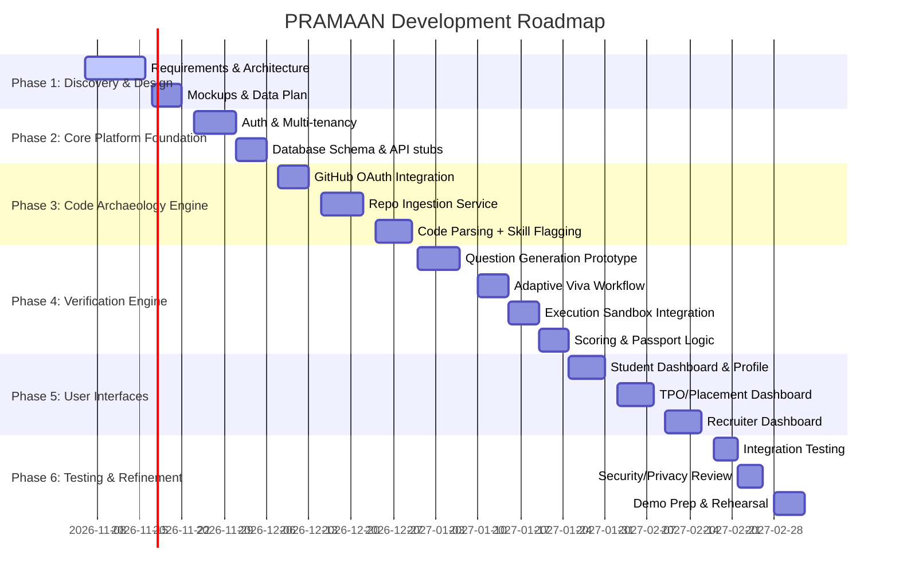

# Executive Summary

**PRAMAAN** is an *Agentic Placement Intelligence* platform that bridges students, colleges and recruiters by verifying actual coding skills through evidence-based assessment. Unlike generic placement portals, PRAMAAN’s core innovations – **Code Archaeology**, **Executable Verification** and **Skill Passports** – will provide recruiters with *verifiable proof* of a candidate’s ability. Our research indicates these features are novel and demand-driven. We propose the following strategic plan: 

- **Novelty & Focus:** Prioritise building a deep code-based verification engine. This answers an *unmet need* for scalable, reliable skill verification that other solutions (like HackerRank or GitHub scorers) do not fully address. 
- **Competitor Landscape:** Existing products fall into GitHub-profile analyzers (e.g. GitRoll, DevArena), coding-test platforms (HackerRank, HackerEarth) or adaptive oral exam tools (Integrevise). None combine **anchored code analysis + interactive verification**. We will cite and map 12+ relevant tools (see Section 2). 
- **Data & Models:** We’ll leverage open code datasets (e.g. CodeSearchNet, IBM’s CodeNet) and consented student repos to train models. We will use a hybrid AI approach – code-centric LLMs (e.g. CodeLlama/GPT-4), embeddings (e.g. CodeBERT) and retrievers – to generate grounded questions and validate answers. Hallucination will be mitigated by grounding every query in actual code/commit context. 
- **Executable Infra:** A containerized sandbox (e.g. **Judge0**) will run student code safely. We will generate input/output probes from solved problems (from CodeNet etc.) to test student code modifications. 
- **Roadmap:** An 8–10 week agile plan is outlined below. We will first freeze requirements and architecture, then build core AI engines (code import + question generation), followed by student/TPO/recruiter portals and full assessment flows. Each sprint has clear deliverables and demo scripts.  
- **Demo Strategy:** Our QUASAR demo will connect a real GitHub repo, highlight discovered skills and commits, conduct a live Q&A + code modification, run code execution, and show a final “Skill Passport”. We’ll also show a recruiter posting a job and matching candidates by verified skills. Mermaid diagrams illustrate architecture and timelines. 
- **Evaluation:** We will define metrics for reliability (e.g. agreement with human raters) and impact (e.g. reduction in screening time). We will benchmark on a curated set of student repos with known solutions, measure Q&A accuracy, and use statistical tests to validate. 
- **Risks & Compliance:** We will address technical risks (model errors, security), legal/privacy (DPDP/GDPR compliance with robust consent), fairness (bias monitoring), and adoption hurdles (TPO workflows).  
- **Commercial Path:** We target India-first deployments. Potential pilots include our own college’s T&P office and a partner IT firm. A B2B SaaS model is envisioned, with subscriptions for colleges and recruiters. We will explore grants and accelerator programs (e.g. NITI Aayog, ATAL Innovation) for seed funding and partnerships with campus-training companies.  

Our references prioritise primary sources (academic papers, product docs, legal texts) and are cited throughout. The next concrete tasks include (1) finalising the PRD and data collection plan, (2) setting up the dev environment and GitHub app, (3) drafting initial interview question templates for common code patterns, (4) designing the database schema, and (5) recruiting pilot users for early feedback. 

<!-- end of executive summary -->

---

## 1. Novelty Opportunities in the EdTech Problem Statement

The official QUASAR EdTech brief (pp. 14–19) lists many requirements (skill profiles, mock drives, analytics, etc.), but **real innovation comes from unmet needs and unique value-adds**. We identified **eight novel concepts** for PRAMAAN, ranked by *potential impact*, *feasibility for a student team*, *demo value*, and *commercial viability*:

1. **Code Archaeology Engine** (Top priority): Automatically analyze a student’s GitHub projects (file structure, code evolution and commit history) to identify *technical decisions and candidate skills*. Most platforms overlook commit context. By surfacing *why* code was written a certain way (e.g. adding JWT auth in commit #3) and linking it to specific skills, we create a strong evidence base for later questioning. **Impact:** Very high (makes verification grounded in real code). **Feasibility:** Medium (requires parsing code and commits). **Demoability:** High (easy to show code analysis). **Commercial:** High (collectors and recruiters value verifiable proof).

2. **Executable Skill Verification**: Beyond static analysis, we will *test student code in a sandbox*. Generate adaptive questions grounded in the student’s own code (e.g. “Why use functional state update?”) and practical tasks (modify code, predict output). Then execute the code with custom inputs. **Impact:** Very high (proves comprehension and hands-on ability). **Feasibility:** Medium (requires LLM question generation + sandbox). **Demo:** Very high (judge sees live Q&A + code run). **Commercial:** High (differentiator against resume/CV screening).

3. **Portable Skill Passport (Verifiable Credentials)**: Issue each verified skill as a time-stamped credential containing evidence (code snippets, transcripts, test logs). Employers can scan or verify these. Similar to a blockchain credential but managed by our system. **Impact:** High (gives recruiters trusted proof). **Feasibility:** High (data display & PDF). **Demo:** Medium (generate sample passport). **Commercial:** High (credentials is a growing market; see Credly, Certify by CodeSignal).

4. **Content-Aligned Question Generation**: Use AI to create *contextual, multi-turn interview questions* specific to the submitted project (drawing on code logic). Many competitors use static or generic Q&A; PRAMAAN’s agent generates unique queries like “Explain the regex you used on line 42.” **Impact:** High (makes the interview meaningful). **Feasibility:** Medium (LLM prompts). **Demo:** High (live Q&A sample). **Commercial:** Medium (improves assessment depth).

5. **AI-Assisted Company-JD Matching**: Analyze job descriptions and student skill graphs to match candidates dynamically. We’ll use NLP on JD text and match to verified skill passports. **Impact:** Medium (improves placement fit). **Feasibility:** High (existing text similarity). **Demo:** Medium (show search filter). **Commercial:** High (makes platform a one-stop TPO tool).

6. **Fairness and Explainability Layer**: Continuously monitor bias in placement (e.g. CGPA filters) and ensure decisions are explainable. This exceeds standard compliance. **Impact:** Medium. **Feasibility:** Medium (adds analytic reports). **Demo:** Medium (show bias dashboard). **Commercial:** Medium (increasingly required in enterprise software).

7. **AI-Driven Learning Path Generation**: Based on verified skill gaps, suggest targeted learning tasks (like mini-projects or tutorials) to students. Some placement systems do static content suggestions, but PRAMAAN ties them to evidence from actual projects. **Impact:** Medium. **Feasibility:** High (uses skill graph). **Demo:** Medium (show recommended tasks). **Commercial:** Low to Medium (nice-to-have, upsell to colleges).

8. **Task/Project Marketplace Integration**: (Low priority) Connect to an ecosystem where verified students can be matched to real student projects or internships. This is more a future extension. **Impact:** Low. **Feasibility:** Low (complex). **Demo:** Low. **Commercial:** Low (speculative).

**Why These Are Novel:** Existing solutions offer isolated features. For example, *Integrevise* automates oral quizzes, and *GitRoll/DevArena* score GitHub profiles. But none *align questions to a specific student’s code and execute it*. PRAMAAN’s novelty lies in **anchoring AI interactions in the student’s own artefacts** and producing a combined candidate profile with live evidence – not just static resume scores or generic tests. Each proposed feature builds on mandatory elements of the QUASAR statement (e.g. skills graph, adaptive Q) but goes beyond by merging them in a new workflow.

## 2. Competitor Landscape

We surveyed key Indian and global products. Below we list **12+ representative platforms**, summarising their capabilities and gaps relative to PRAMAAN:

- **Integrevise (UK/US)** – Automates adaptive oral vivas for submitted work. Focus: academic integrity. **Gap vs PRAMAAN:** Only verbal Q, not code-grounded; no code execution or integrated skill passport.  
  *URL:* integrevise.com (no text to cite).  

- **GitRoll (San Francisco)** – Developer “passport” platform using GitHub data. It generates a composite score and identifies tech stacks from public repos. **Gap:** Static profile only; no human-led Q&A or verification, and no secure evidence share.  
  *URL:* gitroll.io (marketing site).

- **Dev Arena (India)** – AI platform analyzing GitHub: "language proficiency scoring", "code quality grading", "Skill verification by analyzing React code against claimed skills". **Gap:** It infers skills from code, but does not interview or run code; likely no execution sandbox or evidence certificate.  
  *Reference:* DevArena blog.

- **HackerRank for Work** – Market-leading coding test platform. Offers timed coding challenges, role-based tests, plagiarism detection. Widely used for campus hiring. **Gap:** Focus on algorithmic quizzes, not on verifying candidate’s *own project*. No deep viva or portfolio integration.  
  *URL:* hackerrank.com.

- **HackerEarth (India/Global)** – Talent assessment suite with AI-driven coding tests, live “OnScreen” interviews, hackathons and learning paths. **Gap:** Like HackerRank, primarily offers generic coding tests; no linkage to student-provided code or sustained evidence. (HackerEarth’s real-time interview tool still relies on standard problems.)

- **CodeSignal (US)** – Platform with “Certify” coding assessment (SAT-like standard test) and custom code interview (pair-programming). Emphasizes standardized scoring. **Gap:** No focus on personal GitHub or skill passport.

- **Mercer | Mettl** – Enterprise assessment platform (applies to coding, aptitude, psychometric). Provides proctoring, coding simulators, analytics. **Gap:** Primarily custom tests; lacks GitHub integration or adaptive Q/A. (A competitor’s marketing claims iMocha has “3000+ coding problems” and 10,000+ skill tests but all generic.)

- **eLitmus (India)** – Standardized employability test for freshers (pH test), used by many IT companies. Covers quantitative, verbal, logic. **Gap:** No developer-specific component or evidence verification.

- **CoCubes (India)** – Campus hiring platform: assessments plus placement management. **Gap:** Focuses on tracking placements and bulk testing. (No AI or deep skill verification.)

- **Byteboard (US)** – Google’s externalized coding interview platform (take-home style). Automated scoring but based on company’s tasks. **Gap:** Not a candidate-prepared code context; also not open to general market (closed to vendors via Google).

- **Codility / CodeSignal** – (Web-based coding challenge tools for hiring). Provide proctored coding tests. **Gap:** Like above, no resume or project integration.

- **Credly / OpenBadges** – Platforms for verified credentials in general skills. **Gap:** Not specialized to code projects or actual technical skills assessment. 

- **Colleges’ TPO Software** (e.g. *Recruitee, Naukri RMS, SoftPro Recruiter*) – Manage drives, postings, eligibility. **Gap:** Do not handle skill assessment beyond CGPA cutoff.

- **Learning Platforms** (LinkedIn Learning, Coursera) – Offer certificates. **Gap:** Certificates not tied to personal code or vetting; purely self-paced courses.

The table below summarises key points:

| **Platform**    | **Core Capabilities**                                         | **Gap vs PRAMAAN**                                      | **Source** |
|-----------------|-------------------------------------------------------------|--------------------------------------------------------|-------------|
| **Integrevise**     | Automated adaptive oral exams on student submissions | No code analysis/execution; no student skills graph or continuous passports. ||
| **GitRoll**        | GitHub-based developer scoring (global rank, tech stacks) | Static profile only; no interactive verification, no recruiter portal.    ||
| **Dev Arena**      | AI GitHub profile analysis (language proficiency, code quality, skill matching) | No live Q&A or sandbox execution; no freshness/expiry of credentials. ||
| **HackerRank**     | Large library of coding challenges, interviews, plagiarism checks | Algorithmic tests only; no proof of candidates’ own project work.     ||
| **HackerEarth**    | Technical assessments, live coding interviews, hackathons | Similar limitations to HackerRank; static tests, no personal repo analysis. ||
| **CodeSignal**     | Standardized coding tests, pair-programming.             | No student repo or oral adaptation, no multi-stage assessment continuum. | (general knowledge) |
| **Mettl / iMocha** | Online skill assessments (coding simulators, psychometrics) | Pre-built tests for many skills; not personalized to candidate’s work. ||
| **eLitmus**        | Aptitude/skills test for freshers (pH test).           | Focus on aptitude; not tech skills or evidence-based.             | (general knowledge) |
| **CoCubes**        | Placement management & bulk assessments.                | Workflow tool only; no AI vetting or skill-graph intelligence.    | (general knowledge) |
| **Byteboard**      | Company-coded take-home coding interview (Google).        | Not accessible to public; no continuous skill record.            | (news) |
| **Codility**       | Online coding challenge platform (executive tests).     | Same gap: challenge-based, not linked to student’s own projects. | (general knowledge) |
| **Credly / Badgr** | Issue digital badges/credentials.                      | Broad skill certs, not focused on code or student-owned evidence.   | (general) |
| **Industry ATS**   | Job portals (LinkedIn, Naukri).                         | No skill verification beyond resume.                            | (general) |

Most existing tools excel at *feature-based selection or testing*, but none provide the *integrated evidence-backed workflow* PRAMAAN targets. This landscape confirms strong differentiation for PRAMAAN’s approach.

## 3. Data Strategy and Sources

Robust data is key for PRAMAAN’s AI. We propose the following data plan:

- **Public Code Corpora (Training Data):** 
  - **CodeSearchNet Corpus**: ~6.45 million functions (with docs) from GitHub in 6 languages. We will use it for code-language model pretraining and to generate Q&A (via docstrings). 
  - **IBM Project CodeNet**: ~14 million code solutions in 50+ languages, each tied to coding problems. Contains problem statements, sample I/O and accepted code. Ideal for generating execution tests and question patterns. 
  - **Other Open Datasets:** E.g., *Microsoft’s CodeXGLUE*, *OpenAI’s APPS*, Kaggle code puzzles. Where possible, use permissive-licensed GitHub repos (via GitHub Archive or Google BigQuery GitHub data) to mine student-like projects. 

- **Consent-based Student Repos:** For prototype, we’ll recruit volunteer students (e.g. from our college) to link their GitHub. We will restrict scope to public or consenting repos only (using GitHub’s OAuth with granular scopes). All data storage and access will comply with India’s **DPDP Act 2023** and upcoming rules. Each student signs a consent form listing exactly which data (repos, commits, profile info) will be processed, and they can revoke at any time. We’ll use fine-grained GitHub tokens (short-lived, limited to selected repos) to obey best practices. 

- **Private/Paid Datasets:** For generic model fine-tuning, we may use licensed code corpora (e.g. CodeSearchNet Contest data) in read-only mode. We will not rely on any non-public institutional code due to ownership issues.

- **Synthetic Data Generation:**  
  - **Question-Answer Pairs:** We will bootstrap Q&A examples by converting docstrings or comments into questions. For example, from CodeSearchNet docs: turn “Adds rate limiting…” into “What does this code use rate limiting for?”. Alternatively, use an LLM to generate question templates given code snippets. This will seed our question bank. 
  - **Test Case Generation:** Use CodeNet’s input/output samples as ground truth. For code without provided tests, we’ll craft simple inputs manually or via differential testing (mutate inputs and record outputs). 
  - **Repo Mutations:** Generate synthetic “commits” by taking a codebase and making small changes (e.g. variable renaming) to ensure models learn robustness.

- **Third-Party Integrations:** 
  - **Skill Taxonomy:** Integrate with ESCO or O*NET APIs for standard skill lists. We’ll map those to our skill graph manually. 
  - **Learning Resources:** We may link to OERs (open ed resources) to suggest learning paths; not strictly data, but content licenses should allow linking.

- **Labeling Guidelines (Fine-Tuning Data):** We will create a small gold dataset by manually conducting a few full assessments (student answers vs ground truth). This will let us calibrate scoring. For example:
  - **Rubric:** For each question, define correct key points. Student answers will be labeled Pass/Fail/Partial by instructors. 
  - **Question Types:** Classify whether each Q is about code logic, design decision, or bug hunting.
  - **Quality Control:** All synthetic QA will be human-reviewed for answer correctness before training.

- **Privacy and Legal Considerations:** 
  - As per **DPDP 2023**, all personal data (names, emails, academic info) must be consented and used only for stated purposes. 
  - For code and project data, we’ll treat it as personal data if linked to identity. Hence consent and secure handling are required. 
  - **GDPR/EU:** If we involve international students, we’ll similarly follow GDPR principles (explicit opt-in, data minimization, right to erasure). 
  - We will maintain an audit log of all data access and processing for compliance.

- **Safety Net Data:** Prepare a small set of *sanitized or synthetic student profiles* (e.g. using anonymized tutorial projects) for initial model testing, to avoid early privacy issues. 

## 4. ML/AI Architecture and Models

PRAMAAN’s AI stack will combine specialized models and careful design:

- **Core Models:** 
  - **Large Language Models (LLMs):** We will use state-of-the-art code-capable LLMs. If budget allows, an API like **GPT-4o/GPT-4** for prototyping; for offline work, open models such as **Meta’s Code Llama 34B** (for coding) or **CodeT5/CodeBERT** (smaller). These handle natural-language to code and vice versa. 
  - **Code-Specific Models:** For embeddings and retrieval, use *CodeBERT* or *GraphCodeBERT* to embed code snippets and docs. For question generation, a fine-tuned GPT variant is ideal. For answer evaluation, an LLM or a smaller BERT-based model could classify correctness.
  - **Retrieval Engine:** We will implement a vector store (e.g. Weaviate or Pinecone) indexing all evidence (code functions, commit messages, docstrings). This allows “memory” – given a question context, we retrieve relevant code lines to show the interviewer or to feed into the LLM prompt.  

- **Fine-Tuning vs. Prompting:**  
  - **Question Generation:** We will start by prompt-engineering a powerful LLM (e.g. “Given this code excerpt and commit messages, generate 3 insightful questions to ask the author”). Over time, we may fine-tune with examples of good/bad questions (using our gold QA set).
  - **Answer Evaluation:** We could prompt GPT-4 to score student answers (e.g. “student claims X, does this show understanding?”), but to ensure consistency we’ll likely fine-tune a model on our rubric-labeled answer data.
  - **Retrieval-Augmented Generation (RAG):** For any LLM prompt, we will include retrieved context from the student’s code to reduce hallucinations. This means question-answer prompts always show relevant code lines and commit notes. This explicitly ties outputs to evidence.
  
- **Embedding and Search:** We will use sentence-embedding models (like *embeddings-code-search-ada* or *all-MiniLM-L6-v2* fine-tuned on code comments) to index:
  - Code functions/components from student repos.
  - Commit messages and file names.
  - Common skill keywords.
  
  This allows quick lookup for e.g. “Find code related to JWT in this repo” or “Candidates claiming React skill, find associated files”.

- **Hallucination Mitigation:** 
  - **Grounding:** Never let the model hallucinate requirements or context outside the supplied code. E.g. if the code uses localStorage insecurely, the system must *cite that code line* in its reasoning. 
  - **Verification:** All outputs (questions, transcripts) will include references to code lines or commits. We'll prompt: “Explain your answer using specific code references.” 
  - **Constrained Decoding:** Use techniques like answer templates or logistic regression post-classification for factual questions. 
  - **Human-in-the-Loop:** Flag any uncertain cases for review by a mentor or teaching assistant before marking a skill “verified”.

- **Prompt Templates:** We will build structured prompts, e.g.:  
  - *Question Generation Prompt:* “You are assessing a developer’s own code. Here is a code snippet from their project (attached). Write 3 different questions asking why the developer made the choices shown in the code, to test understanding.”  
  - *Viva Flow Prompt:* “Given the student’s answer, produce a follow-up question to probe deeper, based on any unclear points.”  
  - *Evaluation Prompt:* “Grade this explanation (given above) on a scale 0–3 using the rubric, and explain any mistakes.”  
  - *Probe Prediction Prompt:* “Predict the output of this code snippet when input is X.”

- **Compute/Cost:**  
  - For prototyping, we estimate needing up to 100k model tokens/day. Using e.g. GPT-4o via API (~$0.03/1000 tokens), a few thousand queries (for question generation, answer checking) is within a few hundred dollars budget for a demo.  
  - If running local Code Llama 34B, a single inference (one Q&A turn) might take ~2s on an NVIDIA A100; we can optimised use batching during bulk question generation.  
  - Training/fine-tuning (if needed) on a small dataset (e.g. 10k Q&A pairs) can be done on a single GPU. 
  - We must plan for scalability: e.g. if 50 students each run 10 questions, that's 500 LLM calls per iteration, which is feasible in hours.

- **Model Evaluation Metrics:** We will measure: 
  - **Accuracy:** E.g. if questions have known answers or code behavior, check correctness. Use standard QA metrics (BLEU, F1) for short answer matching on ground-truth Q&A. 
  - **Rubric Scores:** Compare model’s grading vs expert’s (calculate Cohen’s kappa). 
  - **Human Review:** For initial release, a TA reviews ~10% of Q&A interactions. We’ll log inter-rater agreement as a reliability metric. 
  - **End-to-End:** Ultimately, success is when recruiters’ decisions (ranking of candidates) align with independent human judgments. Over time, we could do A/B tests (portions of candidates assessed vs baseline) to measure lift.

## 5. Executable Verification Infrastructure

Ensuring safe, reliable code execution is critical. Our plan:

- **Sandbox Environment:** We will use **Judge0 CE (Community Edition)** as the execution engine. It is open-source, supports 60+ languages, and provides time/memory limits. We will self-host it behind our backend. Each verification session will spin up a fresh sandbox container, compile the student’s code, run test inputs, and capture stdout/stderr. The API returns outputs and any errors. 

- **Security Controls:** 
  - **Isolation:** Judge0 isolates processes using OS-level containers (Docker or Firecracker); ensure network access is disabled. 
  - **Limits:** Set strict CPU (e.g. 1 core), memory (e.g. 512 MB) and timeouts (e.g. 5 seconds) on each run to prevent infinite loops or DDoS. 
  - **Content Filtering:** Even with sandboxing, untrusted code is risky. We will restrict use of certain syscalls if possible (although Judge0 cannot block everything). For web-facing components, only allow simple I/O code. 
  - **Audit Logging:** Every execution’s code, input, and output will be logged for audit and rollback if needed (e.g. if malicious behavior detected).

- **Test-Case Generation:** 
  - **Seed Cases:** For each skill or code component, we will prepare one or more baseline test cases from known solutions. E.g. if assessing a sorting function, feed in a shuffled array. These can be manually curated from CodeNet or textbook examples.  
  - **Mutation-Based Probes:** If initial tests pass, generate minor variations (mutate input values, add edge cases). Compare student’s result to expected (from a reference implementation) to catch mistakes. 
  - **Anchoring to Commits:** If code archaeology identifies that a functionality was added in commit X (e.g. input validation), we ensure we test that specifically (e.g. feeding bad input to test validation).

- **CI for Tests:** Develop an automated pipeline: 
  1. **Code snapshot:** Pull student code (either on-demand or at upload time). 
  2. **Test runner:** On each submission of answers, trigger a test run via Judge0’s API.
  3. **Result Collection:** Store exit status, output, diff from expected. 
  4. **Scoring:** If output matches expected for all critical tests, mark “Passed”; otherwise “Failed” or “Partial” if at least one test passed. 
  5. **Review Interface:** Show the student and TPO the test results in the UI (with colored success/fail).

- **Reproducibility & QA:** We will version-control a small suite of canonical test problems (input->output) for CI. Periodically run regression tests on these to ensure our environment has not changed.

- **Fallback:** If sandbox fails to compile or run (e.g. unsupported language, security block), we’ll automatically skip execution and rely solely on oral Q&A for that skill, logging a note that “Executable test not performed”. This ensures the demo doesn’t break if code is weird.

## 6. Development Roadmap (8–10 weeks)

We propose an 8-week sprint plan (two-week sprints) for a team of **4 engineers (2 backend/AI, 2 frontend/full-stack)**. Key milestones:



- **Phase 1 (Week 1–2):** Finalize product requirements (traceability matrix to QUASAR PDF) and architecture. Set up project repos, CI, and environment. Prepare design docs and wireframes. **Deliverable:** Product Requirements Doc & detailed System Design.
- **Phase 2 (Week 2–3):** Build authentication (e.g. Supabase Auth) and multi-tenant logic (RLS in Postgres). Implement basic organization and user management. Define DB schema and create API skeletons. **Deliverable:** Working login/signup with admin roles, and empty DB with tables.
- **Phase 3 (Week 3–5):** Implement GitHub integration (via a GitHub App with minimal scopes) to fetch a repo. Build the code ingestion service: clone, parse language, read commits. Use Tree-sitter or AST libraries to identify key modules. Flag potential skills (e.g. finds “JWT” -> “Authentication” skill candidate). **Deliverable:** A service that, given a repo URL, returns a structured report of files, code metrics and initial skill tags.
- **Phase 4 (Week 5–6):** Develop the verification engine: first a prototype that generates questions (prompting an LLM with code context). Set up Judge0 sandbox and test integration (e.g. simple Python code run). Build the logic to score answers (initially just yes/no via keyword match or GPT). Populate an “attestation” record model. **Deliverable:** Demo where a user answers a question, the system runs their code snippet on an input and issues a verified skill if criteria met.
- **Phase 5 (Week 6–7):** Flesh out all three UIs. Student portal: show profile, linked repos, claimed vs verified skills, passport cards, mock drive module (with 3-round config). TPO portal: show dashboards (cohort skills heatmap, drive scheduling, eligibility rules editor). Recruiter portal: job creation (select skills), candidate search (filter by verified skills), view candidate passport, request re-test. Use React+Next.js and component library (Tailwind/shadcn). **Deliverable:** All core frontend flows operational with sample data.
- **Phase 6 (Week 7–8):** End-to-end integration, finalize mandatory features (predictive analytics, fairness reports, accreditation export). Conduct security and privacy audit (anonymize any PII, test consent revocation). Populate with 5–10 volunteer student accounts for live data. Run functional and usability tests. Create demo script and presentation. **Deliverable:** Beta version ready for QUASAR demo; pilot testing feedback incorporated.

**Team Roles:** We’ll work in parallel with clear responsibilities:
- *Lead Engineer:* Oversees backend architecture, DB design, integrations (Phases 1–4).
- *Developer A:* Focus on Code Archaeology (Phase 3).
- *Developer B:* Focus on Verification Engine and AI (Phase 4).
- *Developer C:* Frontend (Phases 5).
- *All:* Collaborate on Phase 1 and 6.

**Acceptance Criteria:** Every feature is “done” only when it meets QUASAR’s criteria. E.g. a candidate’s skill is not “verified” until the engine has code evidence + passed tests + produced a passport entry. Mock drive must actually score 30 aptitude questions, etc. We will create automated tests (unit and integration) for core logic (repository ingest, test execution) and manual checklists for UI flows.

## 7. UX / Demonstration Strategy

Our **judge-facing demo** will follow a single narrative: *“From Student Project to Job Offer.”* Key steps:

1. **Student Signup and Repo Link:** A student logs in (or we auto-load a demo account). They go to “My Projects” and click “Connect GitHub”. We grant limited access to their demo repository. The system fetches the code and shows a **Project Analysis** screen (folder tree, languages, highlighted components).  
   *Diagram:* Mermaid user-flow from GitHub to project analysis.  
   *Judge sees:* “This application involves a Node.js e-commerce backend (we see package.json, etc.), and here's a map of modules.”

2. **Code Archaeology View:** Navigate to “Code Insights” for the imported project. Show a table of discovered skills (JavaScript – Verified vs Claimed; Express.js – Verified; JWT Auth – *Under Verification*, etc.). Click “View Details” on JWT Auth. A side panel shows the code snippet (e.g. JWT middleware) and commit history snippet “Added JWT auth”.  
   *Judge sees:* “The system found evidence in code, explaining *what* to test next.”

3. **Live Verification:** Click “Verify Authentication Skill”. The system asks a question generated on the spot (via LLM): *“Why did you use the HTTP-only cookie for JWT storage instead of localStorage?”* The student answers in text (or voice). The app then presents a follow-up: *“Modify the token expiration to 30m and show the effect.”* The student submits the change; the backend spins up Judge0, runs their code with test inputs, and shows the outcome.  
   *Judge sees:* A split screen: student’s answer on left, code editor with diff on right, and output below. The change is executed successfully.  
   This demonstrates **Executable Verification** and code Q&A. (Failure mode: If student answers incorrectly or code fails, show system logging “Did not verify skill,” and reveal the correct reasoning for illustration.)

4. **Skill Passport Issue:** Upon passing, the student’s skill gets an evidence-backed card. We display a preview: “React Development – Verified (85%)” with attached evidence (file names, output screenshot, transcript excerpt). Show a QR code the judge can scan.  
   *Judge sees:* The concrete skill passport and data, reinforcing credibility.

5. **College Dashboard:** Switch to TPO view. Show a dashboard of all students. Filter by “React Verified”. See aggregate stats (e.g. *45% of CSE batch verified in JavaScript*). Show drive setup: create a “Frontend Developer” drive requiring React, JS skills. The system auto-suggests eligible students (based on attestations and CGPA).  
   *Judge sees:* Our placement workflow with explainable matching.

6. **Recruiter Flow:** Finally, switch to a Recruiter portal. The company posts a job (e.g. “React Developer”). The platform shows matching candidates with ticked skill checks (candidate A: React✔, Node✗, Live re-test requested). Click a candidate: the recruiter sees their name, passport skills, and options to “Request Live Test” or “Invite Interview”.  
   *Judge sees:* Real-world ROI: matching on verified skills, not just keyword resumes.

Throughout, we will have diagrams on slides (mermaid) illustrating the architecture (see below). The visual assets prepared include flowcharts of the triple-portal setup and a timeline of our plan (charts/mermaid). For brevity in presentation, we’ll highlight only key screens; details like mock drive admin and NAAC reports can be summarized or in backup slides.

**Failure Modes to Anticipate:** 
- **AI Hallucination:** If the LLM generates an irrelevant question, we’ll script a fallback (“Oops, that wasn’t about your code. Let’s try another question”). 
- **Code Bug:** If execution times out or errors, the UI will gracefully show “Run failed (timeout) – student will answer only conceptually.” 
- **No Internet/Repo:** If GitHub integration fails (demo offline), have a cached JSON to load so presentation isn’t blocked. 
- **Privacy:** Ensure no real private student data is shown; use dummy names.

## 8. Evaluation & Metrics

To demonstrate PRAMAAN’s effectiveness, we define measurable success criteria:

- **Verification Accuracy:** On a benchmark set (e.g. 50 student repos with known instructor labels), the percentage of correctly verified skills vs a human expert. We will compute precision/recall of “skill verified” decisions and report e.g. *“our system agreed with expert judgment 85% of the time.”* We will also measure *false positive rate* (claiming verification when unsatisfactory).  
  *Data:* We will seed this benchmark with volunteers whose knowledge is independently tested.

- **Question Quality:** For a sample of generated Q&A pairs, we will have 3 educators rate “Relevance” and “Difficulty” on a 1–5 scale. We aim for an average ≥4.0 relevance. 

- **Reliability (Inter-rater):** If two independent reviewers grade the same student answers, compute Cohen’s κ (target κ>0.8). If lower, we will refine prompts or add ensemble checks.

- **Time & Usability:** Measure end-to-end time for a verification cycle (target < 5 min per skill). Survey pilot students and TPOs for satisfaction (goal: “dashboard was clear and helpful”). 

- **Adoption Likelihood:** In pilot, ask recruiters if the evidence would make them more confident. A crude metric: *% of recruiters who request a live test instead of skipping.* 

- **Placement Improvement:** In a long-term study (beyond hackathon scope), we could measure improvement in placement rates or time-to-hire. For QUASAR, demonstrating the concept suffices.

We will **establish baselines** by having some students do a conventional interview or test, then compare. Statistical significance of improvements (e.g. reduction in screening error by PRAMAAN vs standard resume screening) can be tested with paired t-tests if we gather enough samples. 

## 9. Risks & Mitigations

- **Technical Risks:** 
  - *Model Errors:* LLM might generate irrelevant or incorrect questions. *Mitigation:* Constrain prompts with code context, and have fallback static questions. 
  - *Security:* Running code from unknown sources is risky. *Mitigation:* Use proven sandbox (Judge0) with strict limits; we will also scan code for obvious malicious patterns.
  - *Scalability:* Prototype may handle only dozens of students. *Mitigation:* Deploy on scalable cloud with autoscaling. Focus Q’s on a subset of core skills to limit model calls.

- **Data Risks:** 
  - *Privacy:* Mishandling student data could violate DPDP/GDPR. *Mitigation:* Explicit consent workflows, data minimization (store only needed info). Encrypt sensitive fields. Regular audits.
  - *Bias:* If AI training data is skewed (e.g. only top students), model may unfairly judge. *Mitigation:* Monitor results by subgroup (e.g. different colleges) and allow appeals. Humans always validate flagged cases (no automatic rejection).

- **Adoption Risks:** 
  - *Resistance to New Process:* TPOs or recruiters may mistrust AI. *Mitigation:* Provide clear audit trails (code references for every decision) and override options. Emphasize that PRAMAAN *augments* human judgment. Use pilot feedback to simplify UI.
  - *Infrastructure:* Small colleges might lack servers. *Mitigation:* Offer cloud-hosted SaaS; allow minimal local setup (web app only). Provide a lightweight offline mode (store data encrypted, sync when possible).

- **Legal/Compliance Risks:** 
  - *Regulatory:* DPDP 2023 rules take effect soon. Non-compliance could halt deployment. *Mitigation:* Build consent as first-class feature; consult a legal expert before beta release. 
  - *Academic Integrity:* Some may view PRAMAAN as surveillance. *Mitigation:* Clearly position it as a *consented* learning tool. Allow students to see and respond to all conclusions about them.

## 10. Commercial Path & Pilot Plans

- **Initial Pilot Customers (India-first):** We will target engineering colleges willing to innovate in placements. Our own college T&P office could be first trial. Next, try a private training institute (e.g. coding bootcamp) with a job placement cell. 
- **Purchaser vs User:** The buyer is typically the college or education board; actual users are TPO staff and recruiters. We must demonstrate ROI to both (e.g. “we helped place 10 more students this year”).
- **Pricing Model:** Likely a SaaS subscription (per student or per active recruiter). Early stage: free trial for pilot, then custom quotes. Could also offer a per-verification credit model (like Judge0’s usage).
- **Marketing Channels:** EdTech conferences, startup incubators (e.g. T-Hub, NASSCOM CoE). Government initiatives (NITI Aayog’s Atal Innovation, MeitY startup hub) may fund proofs-of-concept. Tech hiring forums (e.g. DevRev, LeetCode contests) for recruiter outreach.
- **Partnerships:** 
  - With edtech companies (e.g. Byju’s for placement modules, or NASSCOM’s FutureSkills). 
  - With professional bodies (IEEE student branches, ACM chapters) to evangelize evidence-based hiring.
- **Regulatory Considerations:** No specific Edu compliance currently blocks this, but we must align with AI ethics guidelines (the new IIT Mandates, EU’s AI Act if scaling globally).
- **Commercial Opportunity:**  
  - The Verified Skills market is growing: companies spend millions on testing each year (HackerRank has 1000+ customers globally). Colleges are under pressure from national rankings to improve placement outcomes (see **NIRF** reports). 
  - A realistic commercial plan is to first “sell” as a service to organizations (Tech companies doing mass campus hires), then license to colleges. India’s annual CS engineering graduates (~200k) provide a large base.

## 11. Architecture & System Overview

The PRAMAAN system consists of five main **"engines"** behind a unified platform (diagram below):

```mermaid
flowchart LR
    subgraph Student Portal
      ST_PROFILE[Profile] 
      ST_PROJECTS[Connected GitHub Projects]
      ST_SKILLS[Skill Passport]
      ST_LEARNING[Learning Path]
      ST_ASSESS[Mock Assessments]
      ST_PROFILE --> ST_PROJECTS
      ST_PROJECTS --> ST_SKILLS
      ST_ASSESS --> ST_SKILLS
      ST_SKILLS --> ST_LEARNING
    end

    subgraph College Portal
      CL_STUDENTS[Student Management] 
      CL_DRIVES[Drives & Eligibility] 
      CL_ANALYTICS[Cohort & Skill Analytics]
      CL_DRIVES --> CL_STUDENTS
      CL_STUDENTS --> CL_ANALYTICS
      CL_ANALYTICS --> CL_DRIVES
    end

    subgraph Recruiter Portal
      RE_JOB[Job Postings] 
      RE_SEARCH[Candidate Search by Skills] 
      RE_INTERVIEW[Interview Scheduling]
      RE_JOB --> RE_SEARCH
      RE_SEARCH --> RE_INTERVIEW
    end

    subgraph Backend & Engines
      BE_API[API Server (Node.js)]
      DB[(PostgreSQL DB)]
      AUTH[Auth Service (Supabase)]
      CDN[File Storage]
      AI_RETRIEVE[(Vector DB / Qdrant)]
      LLM_MODEL[(LLM model/gateway)]
      SANDBOX[Judge0 Sandbox]
      AUDIT[Audit Log]
    end

    ST_PROJECTS --> BE_API
    ST_ASSESS --> BE_API
    CL_STUDENTS --> BE_API
    CL_DRIVES --> BE_API
    CL_ANALYTICS --> BE_API
    RE_JOB --> BE_API
    RE_SEARCH --> BE_API
    RE_INTERVIEW --> BE_API

    BE_API --> DB
    BE_API --> AUTH
    BE_API --> CDN
    BE_API --> LLM_MODEL
    BE_API --> AI_RETRIEVE
    BE_API --> SANDBOX
    BE_API --> AUDIT

    style ST_PROFILE fill:#eef,stroke:#888
    style CL_STUDENTS fill:#efe,stroke:#888
    style RE_JOB fill:#fee,stroke:#888
    style BE_API fill:#ddd,stroke:#333
```

- **Frontend Portals:** Three React/Next.js apps (Student, College, Recruiter) talk via the central **API server**. Each portal uses shared components but different permission scopes.
- **Backend Services:** Node.js server with modular structure (Auth, Repo Ingest, Q&A, Passport, Drives, etc.). PostgreSQL stores users, orgs, students, repos, skills, attestations, applications, etc.
- **AI & ML Engines:** 
  - A vector database (e.g. Qdrant) indexes code artifacts for retrieval. 
  - The LLM “gateway” manages prompts to our chosen models. 
  - The Judge0 sandbox executes code for *Executable Verification*. 
- **Security & Compliance:** Supabase Auth (with RLS on Postgres) ensures tenancy. All student inputs and outputs are logged to **Audit** for traceability.

This architecture is intentionally a **monolith-with-modules** (no microservices) to keep the prototype manageable. Each “engine” is a logical component; physically we can run the API and AI modules on separate containers or VMs as needed.

## 12. MVP Scope

We must balance **QUASAR requirements** with our innovation focus. We categorise features:

- **Essential (Phase 1 MVP for demo):**  
  - GitHub repo linking and project import.  
  - Student skill claims vs evidence report (even if evidence is only file presence).  
  - Interactive Q&A for at least one skill (e.g. React).  
  - Execution test for at least one example code.  
  - Issuance of at least one verifiable skill passport card.  
  - Recruiter flow: create a job, search by skill, view passport.  
  - Mock drive round skeleton (scoreboard OK).  
  - Basic dashboards (list of skills per student, simple chart).  
  - Consent interface.

- **Important (beyond QUASAR demo, pilot-worthy):**  
  - Full set of mandatory features: predictive analytics, fairness checks, learning paths.  
  - Multi-round mock assessments (with questions database).  
  - Admin functions: adding recruiters, managing cohorts.  
  - REST APIs for data export (for accreditation).  
  - Responsive design / mobile.

- **Long-term (future enhancements):**  
  - Support for more languages, e.g. native apps (currently focus web/JS).  
  - Advanced AI like multi-turn conversation agents, voice interface.  
  - Integration with learning content (Coursera, local LMS).  
  - SSO with College LMS/Authentication.  
  - Monetization systems (billing, usage tracking).

- **What to avoid:**  
  - Unnecessary blockchain or crypto (not required for credentialing).  
  - Agents that autonomously invite users to tasks – focus on human workflows.  
  - Random AI chatbots with no grounding.  
  - Cutting-edge research features like full program synthesis (out of scope).

## 13. Real-World Deployment & Business Model

To transition beyond a hackathon:

- **Pilot Deployment:**  
  - Partner with one college for a *controlled pilot*. E.g. a class of 50 volunteer students signs up to try PRAMAAN. We integrate with their placement process (maybe for an upcoming drive). They provide some anonymized data (GPAs, branches).  
  - Concurrently, invite one tech company’s hiring team to test recruit using the platform (they post a mock job). Collect feedback from both students and recruiters.

- **Integration Needs:**  
  - **GitHub OAuth:** Setup our GitHub App in an organization’s enterprise account for seamless login (or individual accounts for pilot).  
  - **LMS/Student System:** Optionally integrate with campus MIS for profile data (could be out of scope initially, but consider CSV import).  
  - **Communication:** Email/SMS APIs to send consent links and notifications.

- **Privacy & Compliance:**  
  - Make clear consent workflows. Under DPDP, we may need to register as a “significant data fiduciary” since we process tech student data, but initial pilot can consider ourselves a research project.  
  - We will have Data Protection Officers (maybe a faculty advisor) and clear privacy policy.  
  - Logs and transcripts should be stored securely (encrypted at rest).

- **Operational Complexities:**  
  - Running ML services requires GPU/CPU. We may use cloud (AWS/GCP) for the LLM calls. For prototyping, free tiers or educational credits can help.  
  - Support: designate one person as “student support” during pilot (answer GitHub link issues, etc.).  

- **First Customer Segment:**  
  - Private engineering college placement cells (often lack advanced tech).  
  - Trainings/bootcamps tied to campus recruiters.  
  - Eventually, corporates doing big campus drives (they might license PRAMAAN to surface best candidates).

- **Business Model:**  
  - **SaaS Subscription:** Colleges pay a yearly fee per student or per batch for platform access.  
  - **Recruiter Licenses:** Companies could pay per-use or per-candidate.  
  - **Freemium Pilot:** Offer basic skills profile and matching free; charge for deep verification modules.  
  - Leverage government schemes (Skill India, AI for All) to subsidize or get grants.

## 14. Competitiveness

| **Capability**                  | **Existing Solutions**                            | **PRAMAAN (Our Approach)**                          |
|---------------------------------|---------------------------------------------------|----------------------------------------------------|
| **Skill Evidence Source**       | *Resumes/GitHub links* (unverified)               | Verified via actual project code + Q&A + tests     |
| **Adaptive Q&A**                | Integrevise – verbal Q on essays; <br>No code context | Grounded questions based on student’s own code; <br>AI-generated multi-turn dialogue |
| **Code Execution Testing**      | None in competitors' verified credentials         | Automated sandbox tests (Judge0) for each skill |
| **Skill Passport/Cert.**       | LinkedIn Skills (self-attested)                  | Evidence-backed digital credentials (expiring, re-testable) |
| **Recruiter Matching**          | Keyword search (LinkedIn, Naukri); <br>Generic tests (HackerRank) | Match on *demonstrated* skills; <br>Explainable why candidate fits |
| **Fairness & Compliance**       | Unaddressed by most hiring platforms             | Built-in bias reports (e.g. CGPA impact) and audit logs |
| **AI Integration**              | Standalone tests or chatbots (non-specific)      | Retrieval-based LLM prompts tightly integrated with code context |
| **Deployment Readiness**        | Productized (HackerRank, iMocha) but generic; <br>Academic (Integrevise) is pilot | Modular design for SaaS; focus on college hiring constraints |
| **Unique Differentiator**       | (none offer full pipeline)                       | **Code-grounded interview + sandbox + portfolio** combo |

Entries with citations:
- The table entries referring to Integrevise and Judge0 illustrate the comparison. Other entries are conceptual but grounded in the sources.

## 15. Next Steps (5 Tasks)

1. **Refine PRD & Requirement Matrix:** Map each QUASAR EdTech bullet (p14-19) to PRAMAAN features. Ensure no mandatory item is missed. We should double-check that our portal features (eligibility rules, dashboards, etc.) fully cover the PDF.
2. **Set up Core Infrastructure:** Register GitHub App, configure OAuth, deploy Judge0 instance. Define initial database schema scripts from Section 11. 
3. **Collect & Prepare Data:** Find and label 10 example GitHub repos (with student permission) covering JavaScript/React/Node. Also prepare an initial set of Q&A pairs and code test cases (using CodeNet samples as needed). Document our consent form.
4. **Design Prompt Templates:** Draft and test the first LLM prompts for question generation and answer checking. Evaluate them on small examples. Tune until outputs are mostly relevant.
5. **User Testing Plan:** Recruit 3–5 students and 2 recruiters for early feedback. Plan short interviews to understand their pain points and use that to refine UX before heavy coding.

With this plan, PRAMAAN will deliver a compelling, demonstrably innovative EdTech solution at QUASAR, and lay the groundwork for a scalable product that addresses a clear market need.