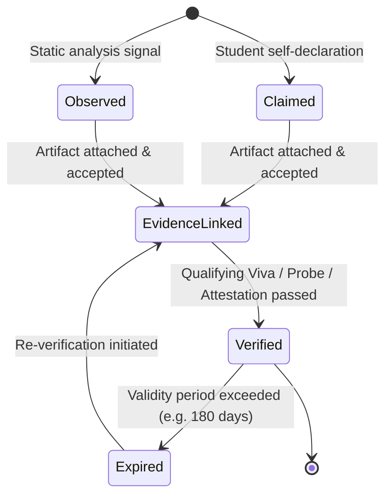
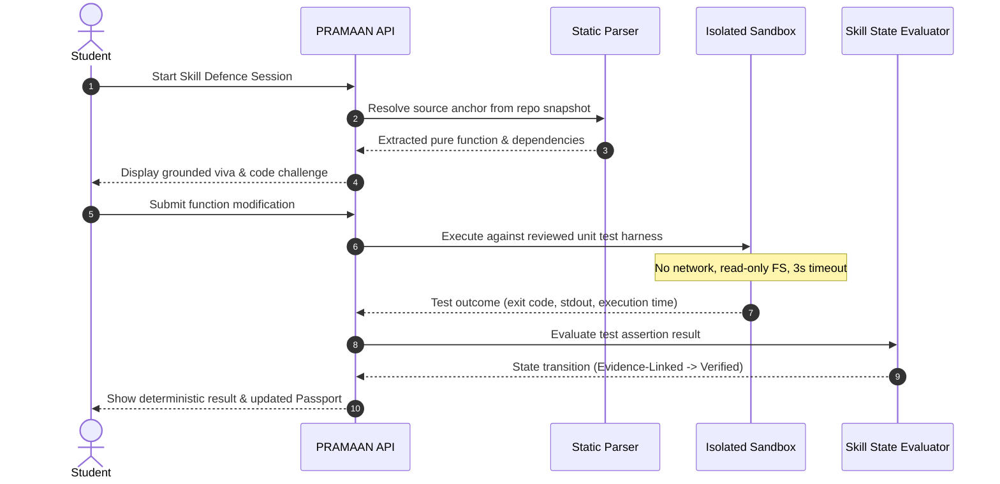

# PRAMAAN — Technical Architecture

**Version:** 1.0.0  
**Pattern:** Modular Monolith with Isolated Execution Service  
**Target Audience:** Engineering, Security Audits, Pilot Evaluations  

---

## 1. Architectural Philosophy & Solo Developer Optimization

PRAMAAN is designed to deliver enterprise-grade multi-tenancy, cryptographic auditability, and verifiable skill defense while remaining maintainable and debuggable by a **single developer**.

### Rejected Complexities
- **No Microservices Mesh:** Distributed transactions, gRPC overhead, and network partition failures are eliminated. A single modular monolith contains business logic while maintaining strict module boundaries.
- **No Vector Databases / Kafka:** Simple relational querying in PostgreSQL with standard indexing and JSONB satisfies taxonomy lookups and event queues without infrastructure maintenance.
- **No Direct LLM Database Access:** AI agents cannot execute arbitrary SQL or write directly to consequential domain tables. All agent outputs are inert `proposals` subject to human review.
- **No Whole-Repository Execution:** Arbitrary student repositories are never cloned and executed wholesale. Only extracted, pure functions with pinned unit tests run in an isolated execution container.

---

## 2. System Architecture & Trust Boundaries

```
[ Browser / Client Portal ]
          │ (HTTPS, JWT, Purpose Scope)
          ▼ [TB1]
┌─────────────────────────────────────────────────────────────┐
│                 PRAMAAN API (Fastify Monolith)              │
│                                                             │
│ ┌────────────────┐ ┌────────────────┐ ┌───────────────────┐ │
│ │ Identity & RBAC│ │ Consent Ledger │ │ Skill Graph       │ │
│ └────────────────┘ └────────────────┘ └───────────────────┘ │
│ ┌────────────────┐ ┌────────────────┐ ┌───────────────────┐ │
│ │ Static Analysis│ │ Rules Engine   │ │ Fairness Engine   │ │
│ └────────────────┘ └────────────────┘ └───────────────────┘ │
│ ┌────────────────┐ ┌────────────────┐ ┌───────────────────┐ │
│ │ Proposal Queue │ │ Placement Cal. │ │ Audit Logger      │ │
│ └────────────────┘ └────────────────┘ └───────────────────┘ │
└─────────┬──────────────────────┬──────────────────────┬─────┘
          │ [TB2]                │ [TB4]                │ [TB5]
          ▼                      ▼                      ▼
┌──────────────────┐   ┌──────────────────┐   ┌──────────────────┐
│ PostgreSQL 16+   │   │ Model Gateway    │   │ Isolated Runner  │
│ - RLS (NOBYPASS) │   │ - Structured Out │   │ - Micro-sandbox  │
│ - Tenant Context │   │ - Schema Val.    │   │ - No Network     │
│ - Hash-Chained   │   │ - Inert Proposal │   │ - Read-Only FS   │
│   Audit Events   │   └──────────────────┘   │ - Timeout Limit  │
└──────────────────┘                          └──────────────────┘
```

### Trust Boundary Definitions
- **TB1 (Browser $\rightarrow$ API):** Authenticated sessions carrying JWT identity. Tenant context (`org_id`) is strictly derived from verified user memberships, never trusted from client payload.
- **TB2 (API $\rightarrow$ Database):** Every transaction sets session-local tenant variables (`SET LOCAL app.current_org_id`). PostgreSQL Row-Level Security (`NOBYPASSRLS`) prevents any cross-tenant data leakage.
- **TB3 (API $\rightarrow$ Workers):** Internal async job dispatch for static parsing, report generation, and notifications.
- **TB4 (Workers $\rightarrow$ Model Gateway):** Untrusted code, JDs, and inputs are framed with defensive prompt wrappers. Output is strictly parsed via Zod schemas into `proposals`. No DB write privileges.
- **TB5 (API/Worker $\rightarrow$ Isolated Runner):** Isolated container or subprocess. Hard resource limits (100MB RAM, 1 CPU core, 3000ms timeout), zero network access, read-only root filesystem.
- **TB6 (Platform $\rightarrow$ External Services):** GitHub OAuth (read-only repository access), SMTP gateway (bulk mail sandbox).

---

## 3. Monorepo Structure

PRAMAAN uses an npm workspace monorepo layout:

```text
pramaan/
├── apps/
│   ├── api/             # Fastify REST API, OpenAPI docs, Route handlers, DB pools
│   ├── web/             # Next.js 15 (App Router), Tailwind CSS, UI Portal
│   └── runner/          # Isolated execution service (test runner & mutation probe)
├── packages/
│   ├── contracts/       # Zod schemas, DTOs, API request/response definitions
│   ├── domain/          # Pure business logic: skill state machine, rules engine, fairness math
│   ├── ui/              # Shared UI components and theme tokens
│   └── config/          # Shared TypeScript, ESLint, and environment configurations
├── db/
│   ├── migrations/      # Ordered SQL migrations
│   ├── seeds/           # Deterministic test and demo seeds
│   ├── policies/        # PostgreSQL Row-Level Security definitions
│   └── tests/           # Dedicated RLS and multi-tenant security test suites
├── docs/                # Architecture, threat model, traceability, and backlog documentation
└── scripts/             # Setup, demo reset, database migration, and test runners
```

---

## 4. Key Architectural Subsystems

### 4.1 Tenancy & Database Enforcement (RLS)
- Every tenant represents a distinct educational institution (College).
- Multi-tenancy is enforced at the database kernel level via PostgreSQL RLS.
- Database connections use a restricted `app_api` role configured with `ALTER ROLE app_api NOBYPASSRLS`.
- Each request initiates a transaction executing:
  ```sql
  SET LOCAL app.current_org_id = :tenant_id;
  SET LOCAL app.current_user_id = :user_id;
  SET LOCAL app.current_user_role = :role;
  ```
- Any query lacking a valid tenant context immediately yields 0 rows or throws a permission error.

### 4.2 Code Archaeology & Anchor Resolution
- **Static Ingestion:** When a student grants consent for a specific repository, PRAMAAN fetches repository metadata and commits via GitHub read-only API. No repository hooks or setup scripts are ever executed.
- **Tree-sitter Parsing:** Extracts functions, classes, and call-graphs to detect demonstrated skills (e.g., Python AST, TypeScript parser).
- **Exact Anchors:** Every evidence item stores an immutable snapshot record:
  $$\text{Anchor} = (\text{Repo SHA}, \text{Relative Path}, \text{Line Start}, \text{Line End}, \text{Content Hash})$$
- If the file content hash does not match at resolution time, the anchor status returns `ANCHOR_INVALID`.

### 4.3 Skill State Machine
Skills transition deterministically through five explicit states:

**Invariant:** Under no circumstances can an LLM directly set `state = 'verified'`. State transitions require an executed verification session with qualifying test results or an authorized mentor attestation.

### 4.4 Live Mutation Probe (Technical Showpiece)


### 4.5 Declarative Eligibility Engine & What-If Simulator
- Criteria (CGPA, maximum backlogs, branch, verified skill requirements) are stored as JSON rules inside an immutable `eligibility_rule_versions` table.
- Evaluation is pure and functional:
  $$\text{EligibilityResult} = f(\text{RuleVersion}, \text{StudentAcademicSnapshot}, \text{StudentVerifiedSkills})$$
- The What-If simulator allows placement officers to execute draft rules against the current cohort, calculating:
  - Total eligible students count.
  - Demographic breakdown (gender, category, branch).
  - Impact ratio ($4/5\text{ths}$ rule):
    $$\text{Impact Ratio} = \frac{\text{Selection Rate of Protected Group}}{\text{Selection Rate of Highest Group}}$$
  - Small group suppression: Any subgroup with $N < 5$ is suppressed from display to prevent demographic deanonymization.
- The simulator is explicitly monitored: all what-if runs are logged to `fairness_simulations` to prevent gaming or arbitrary manipulation.

---

## 5. Technology Stack Summary

| Layer | Primary Technology | Rationale |
| :--- | :--- | :--- |
| **Frontend UI** | Next.js 15, React 19, Tailwind CSS | High productivity, server rendering, modern accessible component ecosystem. |
| **Backend API** | Fastify, TypeScript, Zod | Blazing fast startup (<200ms), low memory footprint, first-class JSON schema validation, automatic OpenAPI generation. |
| **Database** | PostgreSQL 16+ | Industry standard relational integrity, native RLS, JSONB querying, exclusion constraints for calendar clashes. |
| **Code Parser** | Tree-sitter / Babel / Python AST | Deterministic, offline static parsing without executing untrusted scripts. |
| **Sandbox Execution**| Isolated container / Node isolated-vm | Strict memory, CPU, filesystem, and egress boundaries. |
| **AI Gateway** | Centralized gateway (Google Gemini / Anthropic) | Model-agnostic abstraction; strict structured JSON output; schema enforcement before entering proposal queues. |

